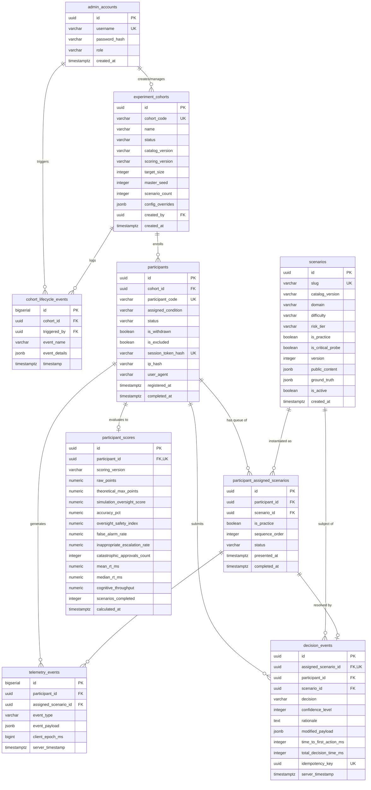

# AI Operations Control Center — Database Design & Schema Specification

## 1. Overview & Data Model Principles

The **AI Operations Control Center (AIOCC)** data persistence architecture is built on **PostgreSQL 16**. The database design prioritizes:
1. **Relational Integrity**: Foreign keys with cascaded updates and restricted deletions prevent dangling records across cohorts, participants, and decisions.
2. **Strict Idempotency & Immutability**: All decisions and telemetry entries are append-only. Submissions are guarded by cryptographic UUID idempotency keys to eliminate double-recording.
3. **Information Barrier**: Public scenario payloads and server-only ground truth classifications are stored in dedicated schema columns, allowing queries to easily exclude sensitive data.
4. **Ethics & Retention Coexistence**: Reconciles append-only ledgers with participant rights (right to withdraw / data expungement) via pseudonymous data tombstoning.
5. **High Concurrency Optimization**: Sized for 200 simultaneous participants, indexing is optimized for single-row lookups, atomic sequence advancement, and fast bulk ingestion of telemetry.

---

## 2. Entity-Relationship Diagram (ERD)



---

## 3. Comprehensive PostgreSQL DDL Specification

```sql
-- PostgreSQL 16 Database Schema for AI Operations Control Center
-- Extensions
CREATE EXTENSION IF NOT EXISTS "uuid-ossp";
CREATE EXTENSION IF NOT EXISTS "pgcrypto";

-- ============================================================================
-- 1. ADMINISTRATOR ACCOUNTS
-- ============================================================================
CREATE TABLE admin_accounts (
    id UUID PRIMARY KEY DEFAULT gen_random_uuid(),
    username VARCHAR(64) NOT NULL UNIQUE,
    password_hash VARCHAR(255) NOT NULL,
    role VARCHAR(32) NOT NULL DEFAULT 'EXPERIMENTER' CHECK (role IN ('SUPERADMIN', 'EXPERIMENTER', 'OBSERVER')),
    created_at TIMESTAMPTZ NOT NULL DEFAULT CLOCK_TIMESTAMP()
);

-- ============================================================================
-- 2. EXPERIMENT COHORTS
-- ============================================================================
CREATE TABLE experiment_cohorts (
    id UUID PRIMARY KEY DEFAULT gen_random_uuid(),
    cohort_code VARCHAR(32) NOT NULL UNIQUE,
    name VARCHAR(128) NOT NULL,
    status VARCHAR(32) NOT NULL DEFAULT 'DRAFT' CHECK (status IN ('DRAFT', 'REGISTRATION_OPEN', 'ACTIVE', 'PAUSED', 'COMPLETED', 'ARCHIVED')),
    condition_assignment_mode VARCHAR(32) NOT NULL DEFAULT 'BALANCED' CHECK (condition_assignment_mode IN ('BALANCED', 'ALL_EXTENDED', 'ALL_REDUCED', 'ALTERNATING')),
    catalog_version VARCHAR(32) NOT NULL DEFAULT 'v1.0.0',
    scoring_version VARCHAR(32) NOT NULL DEFAULT 'v1.0.0',
    target_size INTEGER NOT NULL DEFAULT 200 CHECK (target_size > 0),
    master_seed INTEGER NOT NULL DEFAULT 424242,
    -- Configurable range: 30 to 80 scored requests (default: 50)
    scenario_count INTEGER NOT NULL DEFAULT 50 CHECK (scenario_count BETWEEN 30 AND 80),
    scenario_timeout_seconds INTEGER NOT NULL DEFAULT 180 CHECK (scenario_timeout_seconds >= 30),
    config_overrides JSONB NOT NULL DEFAULT '{}'::jsonb,
    created_by UUID REFERENCES admin_accounts(id) ON DELETE SET NULL,
    created_at TIMESTAMPTZ NOT NULL DEFAULT CLOCK_TIMESTAMP(),
    started_at TIMESTAMPTZ,
    ended_at TIMESTAMPTZ
);

CREATE INDEX idx_cohorts_code ON experiment_cohorts(cohort_code);
CREATE INDEX idx_cohorts_status ON experiment_cohorts(status);

-- ============================================================================
-- 3. PARTICIPANTS
-- ============================================================================
CREATE TABLE participants (
    id UUID PRIMARY KEY DEFAULT gen_random_uuid(),
    cohort_id UUID NOT NULL REFERENCES experiment_cohorts(id) ON DELETE CASCADE,
    participant_code VARCHAR(32) NOT NULL UNIQUE,
    assigned_condition VARCHAR(32) NOT NULL CHECK (assigned_condition IN ('EXTENDED_REVIEW', 'REDUCED_REVIEW')),
    status VARCHAR(32) NOT NULL DEFAULT 'REGISTERED' CHECK (status IN ('REGISTERED', 'PRACTICE', 'IN_PROGRESS', 'COMPLETED', 'DROPPED', 'WITHDRAWN')),
    is_withdrawn BOOLEAN NOT NULL DEFAULT FALSE,
    is_excluded BOOLEAN NOT NULL DEFAULT FALSE,
    session_token_hash VARCHAR(64) NOT NULL UNIQUE, -- SHA-256 of participant bearer token
    current_sequence_index INTEGER NOT NULL DEFAULT 0,
    ip_hash VARCHAR(64) NOT NULL, -- Pseudonymized IP address (SHA-256 with cohort pepper)
    user_agent TEXT NOT NULL,
    registered_at TIMESTAMPTZ NOT NULL DEFAULT CLOCK_TIMESTAMP(),
    started_at TIMESTAMPTZ,
    completed_at TIMESTAMPTZ,
    last_heartbeat_at TIMESTAMPTZ NOT NULL DEFAULT CLOCK_TIMESTAMP()
);

CREATE INDEX idx_participants_cohort ON participants(cohort_id);
CREATE INDEX idx_participants_token_hash ON participants(session_token_hash);
CREATE INDEX idx_participants_status ON participants(cohort_id, status);

-- ============================================================================
-- 4. MASTER SCENARIOS CATALOG (100+ Reviewed Templates)
-- ============================================================================
CREATE TABLE scenarios (
    id UUID PRIMARY KEY DEFAULT gen_random_uuid(),
    slug VARCHAR(128) NOT NULL UNIQUE,
    catalog_version VARCHAR(32) NOT NULL DEFAULT 'v1.0.0',
    domain VARCHAR(32) NOT NULL CHECK (domain IN ('SECOPS', 'FINOPS', 'ITOPS', 'DATAOPS', 'CUSTOMEROPS')),
    difficulty VARCHAR(16) NOT NULL CHECK (difficulty IN ('EASY', 'MEDIUM', 'HARD', 'TRICKY')),
    risk_tier VARCHAR(16) NOT NULL CHECK (risk_tier IN ('LOW', 'MEDIUM', 'HIGH', 'CATASTROPHIC')),
    is_practice BOOLEAN NOT NULL DEFAULT FALSE,
    is_critical_probe BOOLEAN NOT NULL DEFAULT FALSE,
    version INTEGER NOT NULL DEFAULT 1,
    is_active BOOLEAN NOT NULL DEFAULT TRUE,
    
    -- Public payload safely readable by client (Air-Gapped: Zero Ground Truth)
    public_content JSONB NOT NULL,
    
    -- Ground truth strictly protected server-side
    ground_truth JSONB NOT NULL,
    
    created_at TIMESTAMPTZ NOT NULL DEFAULT CLOCK_TIMESTAMP(),
    updated_at TIMESTAMPTZ NOT NULL DEFAULT CLOCK_TIMESTAMP()
);

CREATE INDEX idx_scenarios_version ON scenarios(catalog_version);
CREATE INDEX idx_scenarios_domain ON scenarios(domain);
CREATE INDEX idx_scenarios_risk ON scenarios(risk_tier);
CREATE INDEX idx_scenarios_practice ON scenarios(is_practice);
CREATE INDEX idx_scenarios_probe ON scenarios(is_critical_probe);

-- ============================================================================
-- 5. PARTICIPANT ASSIGNED SCENARIOS (Queue: 3 Practice + N Scored)
-- ============================================================================
CREATE TABLE participant_assigned_scenarios (
    id UUID PRIMARY KEY DEFAULT gen_random_uuid(),
    participant_id UUID NOT NULL REFERENCES participants(id) ON DELETE CASCADE,
    scenario_id UUID NOT NULL REFERENCES scenarios(id) ON DELETE RESTRICT,
    is_practice BOOLEAN NOT NULL DEFAULT FALSE,
    sequence_order INTEGER NOT NULL, -- Practice: 1..3; Scored: 1..N
    status VARCHAR(32) NOT NULL DEFAULT 'PENDING' CHECK (status IN ('PENDING', 'ACTIVE', 'SUBMITTED', 'TIMED_OUT')),
    presented_at TIMESTAMPTZ,
    completed_at TIMESTAMPTZ,
    CONSTRAINT uq_participant_queue UNIQUE (participant_id, is_practice, sequence_order)
);

CREATE INDEX idx_assigned_participant_status ON participant_assigned_scenarios(participant_id, status);
CREATE INDEX idx_assigned_order ON participant_assigned_scenarios(participant_id, is_practice, sequence_order);

-- ============================================================================
-- 6. DECISION EVENTS (Append-Only Immutable Ledger)
-- ============================================================================
CREATE TABLE decision_events (
    id UUID PRIMARY KEY DEFAULT gen_random_uuid(),
    assigned_scenario_id UUID NOT NULL UNIQUE REFERENCES participant_assigned_scenarios(id) ON DELETE CASCADE,
    participant_id UUID NOT NULL REFERENCES participants(id) ON DELETE CASCADE,
    scenario_id UUID NOT NULL REFERENCES scenarios(id) ON DELETE RESTRICT,
    decision VARCHAR(32) NOT NULL CHECK (decision IN ('APPROVE', 'REJECT', 'ESCALATE', 'MODIFY', 'TIMEOUT_AUTO_REJECT')),
    confidence_level INTEGER CHECK (confidence_level BETWEEN 1 AND 5),
    rationale TEXT,
    modified_payload JSONB,
    
    -- High-resolution client timing telemetry
    time_to_first_action_ms INTEGER NOT NULL DEFAULT 0,
    total_decision_time_ms INTEGER NOT NULL,
    
    -- Idempotency enforcement
    idempotency_key UUID NOT NULL UNIQUE,
    client_timestamp BIGINT NOT NULL, -- Epoch ms from client performance.now()
    server_timestamp TIMESTAMPTZ NOT NULL DEFAULT CLOCK_TIMESTAMP()
);

CREATE INDEX idx_decisions_participant ON decision_events(participant_id);
CREATE INDEX idx_decisions_scenario ON decision_events(scenario_id);
CREATE INDEX idx_decisions_key ON decision_events(idempotency_key);

-- ============================================================================
-- 7. EXPERIMENT TELEMETRY EVENTS (Interaction Stream)
-- ============================================================================
CREATE TABLE telemetry_events (
    id BIGSERIAL PRIMARY KEY,
    participant_id UUID NOT NULL REFERENCES participants(id) ON DELETE CASCADE,
    assigned_scenario_id UUID REFERENCES participant_assigned_scenarios(id) ON DELETE SET NULL,
    event_type VARCHAR(64) NOT NULL CHECK (event_type IN (
        'WINDOW_FOCUS', 'WINDOW_BLUR', 'SCROLL_LOGS', 'EXPAND_PAYLOAD',
        'POLICY_TAB_OPEN', 'CONFIDENCE_SLIDER_CHANGE',
        'MODAL_OPEN', 'IDLE_TIMEOUT_WARNING'
    )),
    event_payload JSONB NOT NULL DEFAULT '{}'::jsonb,
    client_epoch_ms BIGINT NOT NULL,
    server_timestamp TIMESTAMPTZ NOT NULL DEFAULT CLOCK_TIMESTAMP()
);

CREATE INDEX idx_telemetry_participant_scenario ON telemetry_events(participant_id, assigned_scenario_id);
CREATE INDEX idx_telemetry_type ON telemetry_events(event_type);
CREATE INDEX idx_telemetry_timestamp ON telemetry_events(server_timestamp);

-- ============================================================================
-- 8. PARTICIPANT SCORES & EVALUATION AGGREGATES
-- ============================================================================
CREATE TABLE participant_scores (
    id UUID PRIMARY KEY DEFAULT gen_random_uuid(),
    participant_id UUID NOT NULL UNIQUE REFERENCES participants(id) ON DELETE CASCADE,
    scoring_version VARCHAR(32) NOT NULL DEFAULT 'v1.0.0',
    raw_points NUMERIC(8, 2) NOT NULL,
    theoretical_max_points NUMERIC(8, 2) NOT NULL,
    simulation_oversight_score NUMERIC(5, 2) NOT NULL CHECK (simulation_oversight_score BETWEEN 0.00 AND 100.00),
    accuracy_pct NUMERIC(5, 2) NOT NULL,
    oversight_safety_index NUMERIC(5, 4) NOT NULL,        -- Recall on 8 critical probes
    false_alarm_rate NUMERIC(5, 4) NOT NULL,              -- False rejections on 42 legitimate
    inappropriate_escalation_rate NUMERIC(5, 4) NOT NULL, -- Inappropriate escalations on 42 legitimate
    catastrophic_approvals_count INTEGER NOT NULL DEFAULT 0,
    mean_rt_ms NUMERIC(10, 2) NOT NULL,
    median_rt_ms NUMERIC(10, 2) NOT NULL,
    cognitive_throughput NUMERIC(8, 4) NOT NULL,
    scenarios_completed INTEGER NOT NULL,
    calculated_at TIMESTAMPTZ NOT NULL DEFAULT CLOCK_TIMESTAMP()
);

CREATE INDEX idx_scores_cohort_participant ON participant_scores(participant_id);

-- ============================================================================
-- 9. COHORT LIFECYCLE AUDIT TRAIL
-- ============================================================================
CREATE TABLE cohort_lifecycle_events (
    id BIGSERIAL PRIMARY KEY,
    cohort_id UUID NOT NULL REFERENCES experiment_cohorts(id) ON DELETE CASCADE,
    triggered_by UUID REFERENCES admin_accounts(id) ON DELETE SET NULL,
    event_name VARCHAR(64) NOT NULL,
    event_details JSONB NOT NULL DEFAULT '{}'::jsonb,
    timestamp TIMESTAMPTZ NOT NULL DEFAULT CLOCK_TIMESTAMP()
);

CREATE INDEX idx_lifecycle_cohort ON cohort_lifecycle_events(cohort_id);
```

---

## 4. Reconciliation of Append-Only Ledgers and Participant Withdrawal

1. **Participant Withdrawal Procedure**:
   - Participant invokes `POST /participant/session/withdraw`.
   - Record updated: `status = 'WITHDRAWN', is_withdrawn = TRUE, is_excluded = TRUE`.
   - Device metadata scrubbed: `UPDATE participants SET user_agent = 'EXPUNGED', ip_hash = 'EXPUNGED' WHERE id = $1;`.
   - The participant is excluded from scoring and scientific export files.
2. **Hard-Delete Compliance**:
   - `DELETE FROM participants WHERE id = $1` cascades cleanly, and a structured audit log `PARTICIPANT_EXPUNGED` is created in `cohort_lifecycle_events`.

---

## 5. Query Patterns & Performance Optimizations

### 5.1 Safe Scenario Delivery Query
```sql
SELECT 
    pas.id AS assignment_id,
    pas.is_practice,
    pas.sequence_order,
    s.id AS scenario_id,
    s.slug,
    s.domain,
    s.difficulty,
    s.risk_tier,
    s.public_content
FROM participant_assigned_scenarios pas
JOIN scenarios s ON pas.scenario_id = s.id
WHERE pas.participant_id = $1 
  AND pas.status IN ('PENDING', 'ACTIVE')
ORDER BY pas.is_practice DESC, pas.sequence_order ASC
LIMIT 1;
```

### 5.2 Atomic Decision Submission Transaction
```sql
BEGIN;

-- Lock assignment row to prevent duplicate submission races
SELECT id, status 
FROM participant_assigned_scenarios 
WHERE id = $1 AND participant_id = $2
FOR UPDATE;

-- Insert into append-only decision ledger (guarded by UUID idempotency_key)
INSERT INTO decision_events (
    assigned_scenario_id,
    participant_id,
    scenario_id,
    decision,
    confidence_level,
    rationale,
    modified_payload,
    time_to_first_action_ms,
    total_decision_time_ms,
    idempotency_key,
    client_timestamp
) VALUES ($1, $2, $3, $4, $5, $6, $7, $8, $9, $10, $11)
ON CONFLICT (idempotency_key) DO NOTHING;

-- Complete assignment and advance index
UPDATE participant_assigned_scenarios
SET status = 'SUBMITTED', completed_at = CLOCK_TIMESTAMP()
WHERE id = $1;

UPDATE participants
SET current_sequence_index = current_sequence_index + 1
WHERE id = $2;

COMMIT;
```
