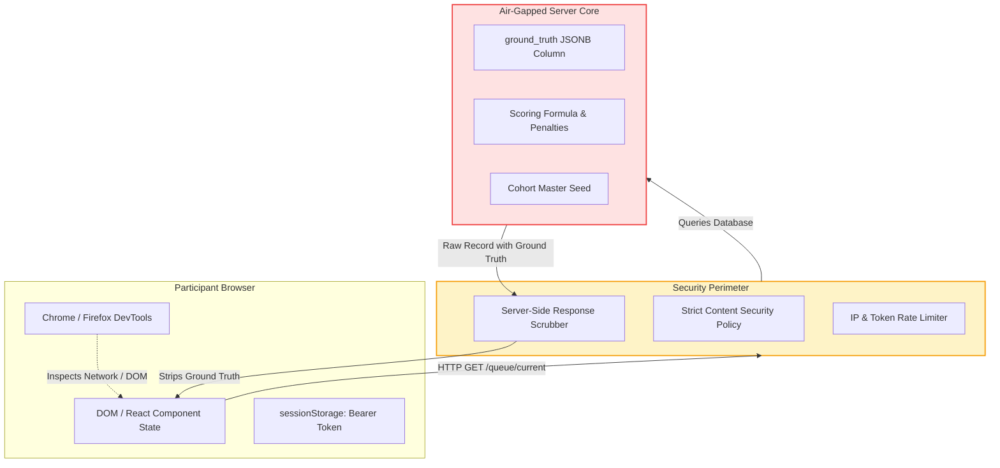

# AI Operations Control Center — Security, Privacy & Threat Model Specification

## 1. Information Barrier & Ground Truth Isolation

The primary security requirement of the AIOCC experimental platform is maintaining the integrity of the scientific experiment by preventing participants from accessing, inspecting, or inferring ground-truth labels and scoring mechanisms.



### 1.1 Server-Side Data Scrubbing Guarantees
- **Zero Client Leakage**: Under no circumstances is the `ground_truth` JSONB object, `is_compliant` boolean, `expected_action` string, or `scoringWeight` integer transmitted to the client.
- **DTO Transformation Enforcement**: Fastify routes enforce TypeBox compiled DTO serializers. If any internal handler attempts to serialize an entity containing sensitive keys to the participant route, Ajv schema compilation drops the unauthorized properties and raises a server-side telemetry warning.
- **Source Map Protection**: Production frontend builds strip all source maps (`build.sourcemap = false`) and minify client bundles to prevent reverse-engineering of UI logic.

### 1.2 Monotonic Timing & Anti-Tampering
- Participants could attempt to manipulate reported Response Times ($\text{RT}$) by modifying client timers or freezing execution in DevTools.
- **Dual-Timestamp Verification**:
  1. The server records `presented_at = CLOCK_TIMESTAMP()` at the exact millisecond the scenario payload is served.
  2. The client records `performance.now()` high-resolution monotonic elapsed time.
  3. When the decision is submitted, the server compares the client's reported `totalDecisionTimeMs` against the server-measured delta:
     $$\Delta_{\text{server}} = \text{server\_timestamp} - \text{presented\_at}$$
  4. If $| \text{client\_rt} - \Delta_{\text{server}} | > 5000\text{ ms}$ (accounting for normal network RTT), the record is flagged in the database as `TIMING_ANOMALY` for sensitivity audit, preventing client-side clock pausing attacks.

---

## 2. Synthetic Scenario Sandboxing & Side-Effect Isolation

### 2.1 Complete Operational Sandboxing
All operational commands (e.g., `S3:PutBucketAcl`, `kubectl drain node-3`, `Stripe:ReleasePayout`) depicted in the interface are **100% synthetic**.
- **No Outbound Network Calls**: The backend application server operates under a zero-external-egress policy for operational actions. It contains zero AWS SDK, GCP SDK, Stripe, Slack, or email credentials.
- **Mock Execution Engine**: When a participant clicks `Approve`, the system records the decision in the database and advances the queue. No external API, webhook, or script is invoked.
- **Sanitized Mock Data**: All company names (e.g., "Acme Corp", "Synthetix Financial"), IP addresses (RFC 5737 documentation blocks: `192.0.2.0/24`, `198.51.100.0/24`, `203.0.113.0/24`), AWS ARNs, and email addresses are synthetic test values.

---

## 3. Privacy, Anonymization & Research Ethics (IRB-Ready Architecture)

> [!NOTE]
> The architectural controls below constitute an **IRB-ready privacy specification** designed to support researchers in obtaining formal Institutional Review Board / Human Research Ethics approval prior to running live participant cohorts.

### 3.1 Participant De-Identification
1. **Zero PII Collection**: Participants are identified strictly by randomly generated alphanumeric codes (e.g., `PT-A-042`). The application does not collect real names, email addresses, student IDs, or employee IDs.
2. **IP Address Pseudonymization**: IP addresses are never stored in plaintext. Upon connection, the IP is hashed using SHA-256 with an ephemeral cohort pepper:
   $$\text{ip\_hash} = \text{HMAC-SHA256}(\text{RemoteIP}, \text{CohortPepper})$$
   The pepper is discarded upon cohort archival, making reverse lookups mathematically impossible.
3. **Informed Consent & Voluntary Participation**: A mandatory pre-experiment screen presents participants with an IRB-standard consent statement detailing the study purpose, task requirements, recorded interaction metrics, and unconditional right to withdraw.

### 3.2 Reconciling Append-Only Immutability with Right to Withdraw
Research integrity demands append-only audit trails, whereas research ethics guarantees the participant's right to withdraw:
- **Tombstone Architecture**:
  1. If a participant exercises withdrawal via `POST /participant/session/withdraw`, their record is flagged: `status = 'WITHDRAWN', is_withdrawn = true, is_excluded = true`.
  2. Device fingerprinting metadata (`user_agent`, `ip_hash`) is immediately wiped to `'EXPUNGED'`.
  3. The participant's decision records are permanently excluded from scoring aggregation and export datasets.
  4. If legal hard deletion is mandated, `DELETE FROM participants WHERE id = $1` cascades cleanly, and a non-identifying audit event `PARTICIPANT_EXPUNGED` is recorded in `cohort_lifecycle_events`.

---

## 4. Threat Modeling (STRIDE Analysis)

| Threat Category | Specific Attack Vector | Risk Level | Architectural Countermeasure |
| :--- | :--- | :--- | :--- |
| **Spoofing** | Participant attempts to impersonate another participant to alter scores. | High | Participant tokens are cryptographically random 256-bit hex strings (`ptok_...`). Token hashes are validated with indexed lookups. |
| **Spoofing** | Attacker attempts to brute-force Presenter admin portal. | Critical | Admin accounts use Argon2id password hashing (memory cost 64MB, 3 iterations). IP rate limiting triggers a 15-minute lock after 5 failed attempts. |
| **Tampering** | Participant alters decision payload in transit (e.g. invalid decision enum or negative timing). | High | Fastify TypeBox schema compiler validates all incoming decision fields; invalid enums receive `400 Bad Request`. |
| **Tampering** | Double-submission of decisions due to rapid multi-clicking or automated scripts. | High | Unique constraint on `decision_events.idempotency_key` and single-row transaction locking (`FOR UPDATE`) prevent race conditions. |
| **Repudiation** | Dispute regarding participant completion or cohort status changes. | Low | Append-only audit logs in `decision_events` and `cohort_lifecycle_events` record immutable timestamps and IP hashes. |
| **Information Disclosure** | Inspecting client network requests to extract ground-truth scenario answers. | Critical | Strict server-side DTO scrubbing removes all ground-truth fields before JSON transmission. |
| **Denial of Service** | Malicious participant floods `POST /telemetry/batch` to exhaust database connections. | High | Fastify token-bucket rate limiter caps telemetry to max 20 requests/minute per session. Telemetry payload size is restricted to 50KB max. |
| **Elevation of Privilege** | Participant accesses presenter endpoints (`/api/v1/admin/*`). | Critical | Fastify pre-handler hook enforces JWT signature validation and role assertion (`role === 'EXPERIMENTER'`). Participant tokens are rejected with `401 Unauthorized`. |

---

## 5. Application Security & Hardening Configuration

### 5.1 Content Security Policy (CSP)
The frontend application is served with an enterprise-grade Content Security Policy:
```http
Content-Security-Policy: default-src 'self'; script-src 'self'; style-src 'self' 'unsafe-inline' https://fonts.googleapis.com; font-src 'self' https://fonts.gstatic.com; connect-src 'self' wss: https:; img-src 'self' data:; frame-ancestors 'none'; object-src 'none'; base-uri 'self';
```

### 5.2 Cross-Origin Resource Sharing (CORS)
- In development: Restricted to `http://localhost:5173` and `http://127.0.0.1:5173`.
- In production: Strict origin matching the deployed domain. Wildcards (`*`) are disallowed.

### 5.3 Input Sanitization & Markdown Injection Defense
- Scenario policies and logs may contain markdown formatted clauses.
- All markdown rendering in the client is parsed cleanly to eliminate any Cross-Site Scripting (XSS) vectors or javascript protocol links.

### 5.4 Presenter Authentication & Hypothesis Privacy Controls
- **Environment-Derived Secret**: Presenter authentication is strictly enforced via the `PRESENTER_KEY` environment variable. The application never ships default fallback credentials.
- **Fail-Closed Architecture**: If `PRESENTER_KEY` is not provided in a production environment (`NODE_ENV === 'production'`), server initialization immediately throws a fatal exception and halts. In non-production environments, all mutating presenter routes fail closed (`401 Unauthorized`).
- **Credential Rotation Policy**: Any previous development fixture credentials (such as the legacy Phase 2 literal `AIOCC_PRESENTER_SECRET_2026`) are strictly rejected and must be immediately rotated if ever used on an active deployment. Actual secret values are never printed to console logs or error outputs.
- **Hypothesis Privacy & Experimental Double-Blind Protection**: Prior to the presenter explicitly toggling `revealUnlocked: true`, the API strictly masks condition-disaggregated metrics (`conditionAMetrics: null`, `conditionBMetrics: null`), focal probe catch rates, and participant condition assignments (`condition: 'MASKED'`). Concluding or pausing the session does not disclose condition-level metrics. The presenter interface hides all condition contrast cards and habituation titles until the activity concludes and the reveal is explicitly unlocked.
